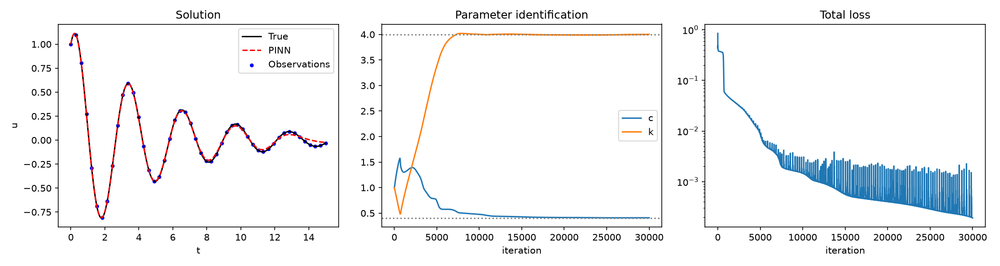
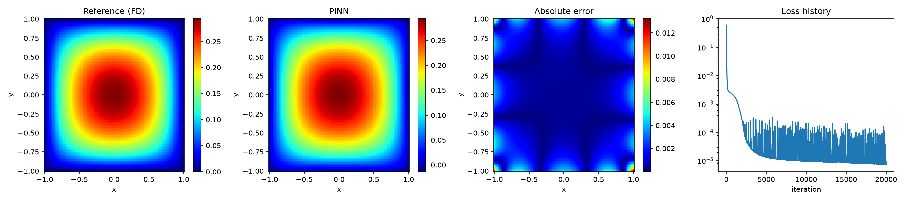
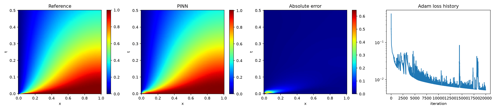

# Physics-Informed Neural Networks for Mechanics Problems

UE24CS352A Machine Learning – Mini-Project (Problem 13)
SRN: PES1UG24CS648

Reproduction of *"Data Driven Solutions and Discoveries in Mechanics Using Physics Informed Neural Network"* (Zhang, Chen & Yang, Stanford CS229, 2020) using PyTorch.

A physics-informed neural network (PINN) approximates the unknown solution with a neural network and puts the governing equation into the loss using automatic differentiation:

`L = w_f * L_f (PDE residual) + w_b * L_b (boundary / initial conditions) + w_d * L_d (data mismatch)`

For the inverse problem, the unknown physical parameters are trained together with the network weights.

## Experiments

| Script | Problem | Type | Reference solution |
|---|---|---|---|
| `pinn_consolidation.py` | 1D soil consolidation (diffusion PDE) | Forward | Analytical series |
| `pinn_heat.py` | 2D steady-state heat conduction (Poisson equation) | Forward | Finite-difference solution |
| `pinn_oscillator.py` | Damped oscillator, identify `c` and `k` | Inverse | Analytical (true c = 0.4, k = 4.0) |

Note: the paper uses a deal.II finite-element reference for the heat problem. This project uses a finite-difference solver (scipy) instead.

## Project structure

```
.
├── pinn_consolidation.py
├── pinn_heat.py
├── pinn_oscillator.py
├── README.md
├── docs/                      # write-up PDF
└── results/                   # result figures
    ├── pinn_consolidation_results.png
    ├── pinn_heat_results.png
    └── pinn_oscillator_results.png
```

## Setup

Requires Python 3.9+.

```bash
git clone <your-repo-url>
cd <repo-folder>
python -m venv venv
venv\Scripts\activate           # Windows
# source venv/bin/activate      # macOS / Linux
pip install torch numpy scipy matplotlib
```

## Run

```bash
python pinn_oscillator.py       # prints c, k during training, saves pinn_oscillator_results.png
python pinn_heat.py             # saves pinn_heat_results.png
python pinn_consolidation.py    # saves pinn_consolidation_results.png
```

Each script trains the network, prints the final error, and saves a result figure (close the plot window for the script to finish). For a quick test, lower `EPOCHS` (`EPOCHS_ADAM` in the consolidation script) at the top of the file.

## Settings used

| Script | Network | Training points | Optimiser |
|---|---|---|---|
| `pinn_oscillator.py` | 3 x 32 tanh | 50 observations, 100 residual points | Adam, 30,000 epochs, lr 1e-3 |
| `pinn_heat.py` | 4 x 50 tanh | 1500 interior, 500 boundary | Adam, 20,000 epochs, lr 5e-4 |
| `pinn_consolidation.py` | 5 x 50 tanh, output multiplied by x | 500 residual, 250 initial, 125 Neumann | Adam, 20,000 epochs, lr 1e-3, then L-BFGS |

## Results

| Problem | Metric | Result |
|---|---|---|
| Oscillator (inverse) | Identified c, k (true 0.4, 4.0) | **c = 0.4099, k = 4.0019** |
| Heat conduction (forward) | MSE / max abs. error vs. finite differences | **2.535e-06 / 1.327e-02** |
| Consolidation (forward), full domain | MSE / max abs. error vs. analytical | **7.107e-04 / 0.648** |
| Consolidation (forward), t >= 0.02 | MSE / max abs. error vs. analytical | **2.354e-04 / 0.140** |

Observations:

- The oscillator parameters are recovered to within 2.5% (c) and 0.05% (k).
- For heat conduction the largest error is near the boundary corners, because the Dirichlet condition is imposed through the loss rather than exactly.
- For consolidation the error is concentrated near x = 0, t = 0, where the solution jumps from 1 to 0, which is why the full-domain max error is much larger than the error for t >= 0.02.
- Errors are somewhat larger than in the paper, which trained for more epochs (50,000-100,000).

### Figures

**Oscillator (inverse problem)**



**Heat conduction**



**Consolidation**



## Reference

Q. Zhang, Y. Chen, Z. Yang, *Data driven solutions and discoveries in mechanics using physics informed neural network*, Stanford CS229 project report, 2020. https://cs229.stanford.edu/proj2020spr/report/Zhang_Chen_Yang.pdf

## Install Dependencies

pip install -r requirements.txt

## Presentation

The project presentation is available at:
docs/PINN_Mechanics_Presentation.pptx
